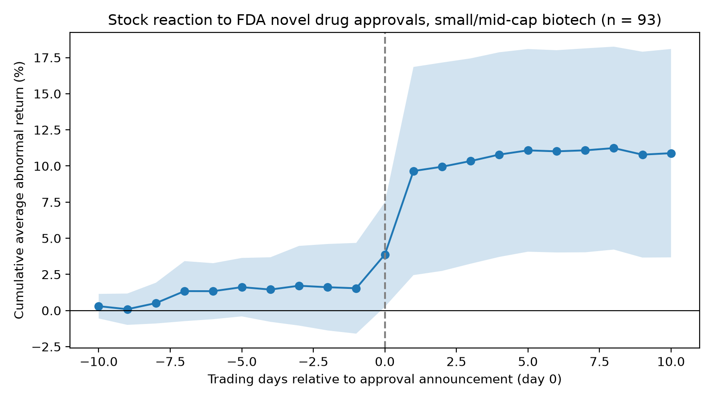

# FDA Approval Event Study: Biotech Stock Reactions to Novel Drug Approvals

How do small and mid-cap biotech stocks react when the FDA approves a novel drug, and what explains differences in the reaction?

## Key findings
- **Approvals produce significant positive abnormal returns.** Across 93 events (2015–2025), the mean CAR[-1,+1] is **+8.0%** (t = 2.52, p = 0.013); the median is +1.4%, and 57% of events are positive.
- **The result is robust.** It holds under a BMP standardized test (p = 0.012), 5%/95% winsorization (+5.0%, p = 0.001), and excluding the largest suspected outlier (+7.7%, p = 0.019).
- **Most of the reaction occurs on days 0 and +1**, consistent with after-hours approval announcements, followed by a modest further drift (CAR[0,+5] = +9.5%, p = 0.005).
- **Firm characteristics explain little of the variation** (R² ≈ 0.10). Size has a negative sign (p = 0.10 in OLS), and pre-event run-up is marginally negative in a median regression (p = 0.07).

## Method
- **Events:** FDA's official compilation of novel drug approvals, 2015–2025 (511 approvals), screened to 226 candidates and 93 events using rules set before looking at returns: US-listed sponsor (or parent), market cap of $300M–$10B on day -1, at least 250 trading days of history, and no confounding company news within ±5 trading days.
- **Timing:** day 0 set from press-release timestamps where researched by hand (after-close announcements move to the next trading day), otherwise the FDA approval date; the three-day main window absorbs one-day timing differences.
- **Confounders:** identified from SEC 8-K filings (earnings, material agreements, financings) and stock-offering prospectuses, with flagged events reviewed by hand.
- **Model:** market model estimated by OLS over trading days -250 to -31, using SPY as the market benchmark; abnormal returns summed into CARs over [-1,+1] and [0,+5].
- **Tests:** one-sample t-test, Wilcoxon signed-rank test, and BMP-style standardized test; cross-sectional OLS with robust (HC1) standard errors, and median regression.

Full rules and every decision are documented in [METHODOLOGY.md](METHODOLOGY.md).

## Data
- Prices and market caps come from CRSP (via WRDS), which includes delisted and acquired companies and avoids the survivorship bias of free sources. CRSP data is licensed and not included in this repository; the notebooks reproduce the results with WRDS access.
- FDA approval data and SEC filings are public.

## Limitations
- Confounding news published only in the press (not in SEC filings) may be missed.
- Some companies raised equity right after day +5, which falls outside the main windows.
- The cross-sectional regressions have limited power with 93 noisy events.

## Repository structure
- `notebooks/01_build_event_list.ipynb`: FDA data and first-pass screening
- `notebooks/02_automate_research.ipynb`: early automation (SEC-based), superseded by notebook 04
- `notebooks/03_event_study.ipynb`: prototype event study on Yahoo data
- `notebooks/04_crsp.ipynb`: CRSP matching, final screening, event study, tests, and regressions
- `METHODOLOGY.md`: all rules and decisions